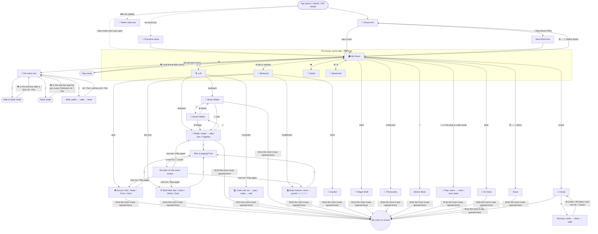

# Navigation map and rules

_Written 2026-11-27 (navigation review); updated for v1.85 (one end box, pet games back to the pet menu) and v1.86 (every Back shows where it goes). Keep it up to date when a screen, mode, game or way out is added._

This page answers "how does a child get into each part of the app, and how do they get back out?". It comes from reading
the code (`show()` in `web/js/09-screens.js`, every Back handler and every end-of-game box), not from the screens alone.
The rules every new feature must follow are in `CLAUDE.md` ("Navigation rules"); the work to make the app follow them is
Phase 16 in `PLAN.md`.

**The most important fact:** the iPads and the iPhone have **no Back button and no swipe-back** in this app. The Home Screen
app opens without Safari's bars, and the app never uses the browser history. `window.androidBack` (`99-startup.js`) only
runs on the Android tablet. **On the children's devices, the buttons on the screen are the only way out of anything.**

## How getting around works
- **Her room is the hub.** The other rooms hang off it: ⬆️ the Loft, ⬅️ the Backyard (her window is a shortcut too),
  ➡️ the Studio, ⬇️ the Basement. The arrow tabs sit at the edges of the room picture; the 🗺️ map shows every room.
- **Screens remember which room they were opened from.** `show('room')` keeps `roomNo`, so leaving Soccer lands in the
  Backyard and leaving the Stage lands in the Loft. Opening a room from the rooms list (`enterRoom()`) always starts in her room.
- **Room modes** (🔍 I Spy, 🙈 Hide & Seek, 🎾 Fetch) are not screens: they play inside the room on screen, hide the top bar,
  the room arrows and the round buttons, and show a card at the top instead.
- **Boxes** (`modal()`) close only with one of their own buttons. Tapping outside does nothing.
- **🧸 Little mode** (`lockGuard`, section 66) sends any screen not in `LOCK_SCREENS` back to the room, keeps to her room and
  the Backyard, and hides ⚙️ (so switching rooms needs a grown-up).
- **Two-player games** pick the second player in a box (another room or 👤 Guest). The game stays on the first player's
  screen; leaving the screen ends the duel; the end box offers "Just me" or "Play again".
- **Leaving the app** saves, pauses a Stage song (⏸️, then ▶ and 3-2-1), ends a Jam, and stops the Music and Dance Makers.
  **A refresh, a crash or iOS closing the app** always opens on the rooms list (a locked Little room opens straight back up).
  A round in progress is lost; coins are already saved; an Art Desk drawing comes back as a draft.

## The map

## Every screen, mode and box

"Back" here means a button on the screen (the Android key is extra). Since v1.86 every top-bar Back is ⬅ + a picture of
where it goes + its name (`backBtn`, `NAV_PLACES` in `76-nav.js`), at least 48 px; on a narrow phone only ⬅ + the picture show.
"⬅ + room" below means the room the screen was opened from (⬅ 🌳 Backyard, ⬅ 🪜 Loft, ⬅ 🏠 My Room…). No screen has a separate Home button; the 🗺️ map
is the only "go to my room" control.

| Screen | Entry points | Exit points | Has back? | Has home? | Notes |
|---|---|---|---|---|---|
| Rooms list | App start, refresh, restore, ⚙️ → 👥 | Tap a room (1 tap, no question), + New (PIN) | – | – | A locked Little room skips it on start |
| Rooms 1–5 | Rooms list, arrow tabs, 🗺️ map, window → Backyard | Hotspots, top bar, arrow tabs | No (Android: room → her room → rooms list) | 🗺️ map | Only way to the rooms list is ⚙️ → 👥 |
| Decorate (mode) | 🛋️ | ✔ Done | ✔ Done | – | Leaving the room ends it |
| Settings (box) | ⚙️ | ✖ Close (gray, last), 👥 Switch, 💌 About, 🎁 Gift… | ✖ Close | – | Hidden in Little mode. PIN and Backup boxes: ⬅ ⚙️ Settings |
| About | ⚙️ → 💌 | ⬅ ⚙️ Settings | ✔ | – | Reopens Settings (v1.86) |
| Sticker Book | 📒 | ⬅ + room | ✔ | – | |
| Fidget Shelf | Shelf | ⬅ + room | ✔ | – | 6 tabs, no end |
| Closet | Closet | ⬅ + room | ✔ | – | |
| Runway | Closet 👠 | ⬅ 🃏 Cards → ⬅ 👗 Closet; end box: ⬅ 👗 Closet / ✨ Wear it home / 🔁 Another card | ✔ (3 steps) | – | Back during the walk skips the show (no coins) |
| Art Desk | Desk | ⬅ + room (asks to save), 🖼️ Gallery | ✔ | – | The only screen that warns before leaving |
| Photocards | Corkboard | ⬅ + room, 📒 Binder | ✔ | – | |
| Soccer | Backyard goal | ⬅ 🌳 Backyard; end box: ⬅ 🌳 Backyard / 🔁 Play again | ✔ | – | Back mid-match drops it without asking |
| Ball Field | Bat rack | ⬅ 🌳 Backyard; end box: ⬅ 🌳 Backyard / 🔁 Play again | ✔ | – | |
| Tricks, Derby | Their mode tab | End box: ⬅ 🌳 Backyard / 🔁 Again / ▶ Next | top bar ✔ | – | |
| Duels (Soccer, Ball) | 👯 tab → who box | End box: ⬅ 🌳 Backyard / ⚽⚾ Just me / 🔁 Play again | top bar ✔ | – | Leaving the screen ends the duel |
| Stage | Loft marquee, 🎸 in the Music Maker | ⬅ 🪜 Loft → ⬅ 🎵 Songs → ⬅ 🎵 Loops (the picture changes with the step); end box: ⬅ 🎵 Songs / 🔁 Play again | ✔ | – | Pauses when the app is left; Back mid-song drops it |
| Jam | Stage 🎸, Music 🎸 | ⏹️; Back → loops → songs or Music; end box: ⬅ 🎵 Loops / 🔁 Again | ✔ | – | |
| Dance Maker | Music 💃, Stage 💃 | ⬅ 🎹 Music / ⬅ 🎤 Stage | ✔ | – | No end |
| Music Maker | Loft keyboard | ⬅ 🪜 Loft | ✔ | – | The loop is kept (`music.cur`) |
| Code Lab | Loft computer | Puzzle → list → room; maker: edit → levels → room; end box: ⬅ 🧩 Puzzles / ▶ Next (🔁 Again on the last one) | ✔ | – | |
| Brain Games | Chalkboard | Puzzle → menu → room; end box: ⬅ 📚 Games / ▶ Next (🔁 Again on the last one); 👯: ⬅ 📚 Games / 🔁 Play again | ✔ | – | Back from a puzzle goes to the menu, not that game |
| Garden | Shed | ⬅ 🌳 Backyard | ✔ | – | |
| 🧸 Play | 🧸 button; the desk in Little mode | Toy → ⬅ 🖍️ Pictures / ⬅ 🧸 Play → ⬅ + room | ✔ | – | No end (by design) |
| I Spy (mode) | 🔍 | ✖; end box: ⬅ + this room (stays here) / 🔁 Again | ✖ | – | Top bar and arrows hidden |
| Pet menu (box) | The pet | ✖ Close, 🙈, 🎾, 🦮, 🛖 Home | ✖ Close | – | |
| Hide & Seek (mode) | Pet menu | ✖ → the pet menu; after a find the end box: ⬅ 🐾 Pet / 🔁 Hide again | ✖ | – | Fixed in v1.85 |
| Fetch (mode) | Pet menu | ✖ → the pet menu; a tap on the pet or every 5 fetches: ⬅ 🐾 Pet / 🔁 Keep playing | ✖ | – | Fixed in v1.85 |
| Walk | Pet menu | ⬅ 🐾 Pet / ⬅ 🛤️ Paths; end box: ⬅ 🐾 Pet / 🔁 Another walk | ✔ | – | Back to the pet menu (v1.85) |
| 🗺️ map, 👯 who box, gift, visitor | Their buttons | ✖ Close / ✖ Not now | ✔ | – | |

## Issues found (2026-11-27)

Severity: **High** = a child gets stuck or can't tell the choices apart; **Med** = confusing or easy to do by mistake;
**Low** = polish. Effort: S = small, M = medium. The Phase 16 PR that fixes each one is in the last column (see `PLAN.md`).

| # | Where | Problem | Who | Fix | Effort | Severity | PR |
|---|---|---|---|---|---|---|---|
| 1 | 🙈 Hide & Seek, 🎾 Fetch | After a find the room looks normal but ignores every tap; the top bar and arrows stay hidden; the only ways out are 🔁 / ✖ at the top; ✖ lands in the room, not the pet menu. Fetch never ends. Too few things = it quits by itself after 1.8 s with only text. | 3–8, pre-readers | End each round with the shared end box (🔁 Again / ⬅🐾 pet menu); ✖ reopens the pet menu; Fetch offers the box on a pet tap or every 5 fetches | S | High | ✅ v1.85 |
| 2 | Every end box | "Play again" has no icon (Soccer, Keeper, Batting, Catch, Stage, Stage Together). Button order flips (Walk, I Spy, Runway put "again" first). The way-out button has 9 names. | Pre-readers | One shared end box: 🔁 right and pink, ⬅ + place icon left | S–M | High | ✅ v1.85 |
| 3 | End boxes after quick tapping (Batting, Stage, Number Pop, Catch) | The box's buttons work at once, so the next quick tap can press "⬅ Backyard" | 3–5 | Buttons wait about 0.5 s | S | Med | ✅ v1.85 |
| 4 | Back mid-round: Soccer, Keeper, Batting, Catch, Derby, a Stage song, a Runway walk, a Jam | The round is dropped without asking (only the Art Desk asks) | All, most of all toddlers | Back during a round pauses and asks with icons: big ▶ keep playing, small ⬅ leave | M | Med | v1.87 |
| 5 | Every top-bar Back (`.btn.small`) | About 33 px tall in normal rooms, under the 48 px rule (52 px in Easy) | 5–8 in normal rooms | At least 48 px everywhere | S | Med | ✅ v1.86 |
| 6 | "⬅ Room" labels | From Backyard and Loft games it says Room but lands in the Backyard or Loft; Garden says Yard; the Ball Field box says Backyard | Readers misled; pre-readers get no picture | Back shows where it goes: ⬅🌳, ⬅🪜, ⬅👗, ⬅🐾 | S | Med | ✅ v1.86 |
| 7 | 🏠 | Means 4 things: her room (map), the room you came from (Walk), the Closet (Runway), stay here (I Spy) | Pre-readers | 🏠 only ever means her room; ✔ for "done, stay here" (pet homes are 🛖, Layouts 📐, the Room & Style stickers 🪞) | S | Med | ✅ v1.86 |
| 8 | ⬅ in the room | The ⬅️🌳 arrow tab means "go left to the Backyard"; everywhere else ⬅ means "back" | Pre-readers | Owner's choice (v1.86): no door look; the arrow + the room's picture is enough, and ⬅ Back now always carries a place picture too. The Basement gets its own 🧱 | S | Low–Med | ✅ v1.86 |
| 9 | Whose room? | Only the room title says it (as text); game screens show only coins. The rooms list opens any room with one tap, so a sibling can spend another's coins (Undo lasts 10 s) | Two children on one device | The buddy's face + badge next to the coins on every top bar (the per-room picture lock stays parked, idea 13) | S | Med | v1.88 |
| 10 | 🔒 Little mode with no PIN | With no PIN, holding 🔒 for 3 s unlocks: a toddler can do that | 3-year-olds | Owner's choice: a PIN needed for Little mode, or a second step | S | Med (only without a PIN) | v1.88 |
| 11 | A locked Little room on a shared device | ⚙️ is hidden, so an older sibling needs a grown-up to switch; the app reopens into the locked room | Shared devices | Owner's choice, e.g. a "👥 hold to switch" that only opens the rooms list | S | Low–Med | v1.88 |
| 12 | Pet → 🦮 Walk | Back and 🏠 Home go to the room, not the pet menu she came from | 3–8 | Back to the pet menu | S | Low | ✅ v1.85 |
| 13 | Depth | Memory for 2 takes 5 taps (Backyard → chalkboard → Memory → 👯 → who); a Runway show 4, Jam 4, duels 4, Dance 3; 🎁 Give a gift sits among the grown-up items in ⚙️ | Older children | Shortcuts one level up (owner's choice which) | S | Low | v1.88 |
| 14 | About | Back goes to the room, not Settings | Grown-ups | Reopen Settings | S | Low | ✅ v1.86 |
| 15 | Arrow tabs at the edges of the room | A toddler tapping around can jump rooms (only her room ↔ Backyard when locked) | 3 | Probably fine; watch on a device | – | Low | – |
| 16 | Close words in boxes | Close (pink in Settings, gray elsewhere), ✖, ✖ Not now, Done, Yay! ✨, Keep it, Cancel; mostly text only | Pre-readers | ✖ Close (gray) in every box, ✔ Done for "finished, stay here" | S | Low | ✅ v1.86 |
| 17 | Spoken help in normal rooms | Read to me follows Easy mode, so a pre-reader on ⭐ Normal hears nothing unless it is turned on | 5-year-olds on Normal | A line in the grown-up setup; the 🔊 buttons stay | S | Low | v1.88 |

Taps from her room (counting the room arrow): Fidget Shelf, Closet, Art Desk, Photocards, Stickers, 🧸 Play, I Spy, the pet
menu: 1. Music Maker, Stage, Code Lab, Soccer, Ball Field, Brain Games, Garden, Hide & Seek, Fetch, Walk: 2. Keep, Tricks,
Catch, Derby, a Brain game, 📅, Dance Maker, a walk path: 3. Duels, Jam, a Runway show: 4. Memory for 2: 5.

## Needs checking on a device
- Real tap sizes and reach on the iPads, upright and sideways; where thumbs rest when holding the iPad (near the top-left Back?).
- Whether an end box that opens mid-tap really catches a stray tap (Batting and the Stage first).
- Whether 3–5-year-olds notice the ✖ / 🔁 card in Hide & Seek, or just keep tapping the room.
- How often iOS closes the app in the background (it then reopens on the rooms list or the locked room).
- Whether each child opens the app from the Home Screen or from Safari: in Safari, swipe-back and pull-to-refresh can leave or reload the page.
- Whether the iPad voices make Read to me good enough for pre-readers in ⭐ Normal rooms.
- Whether siblings really wander into each other's rooms from the rooms list (how urgent #9 and the picture lock are).
